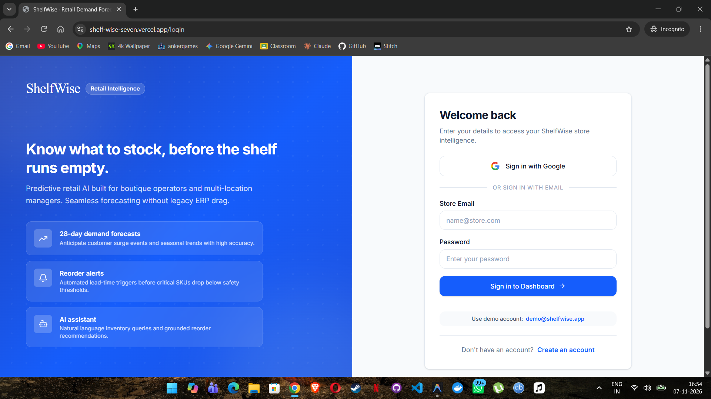
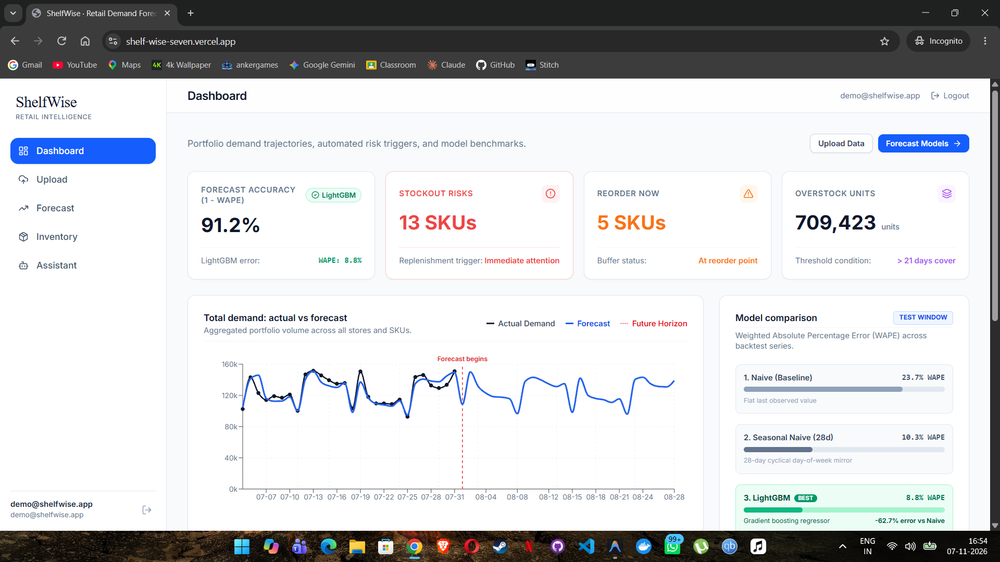
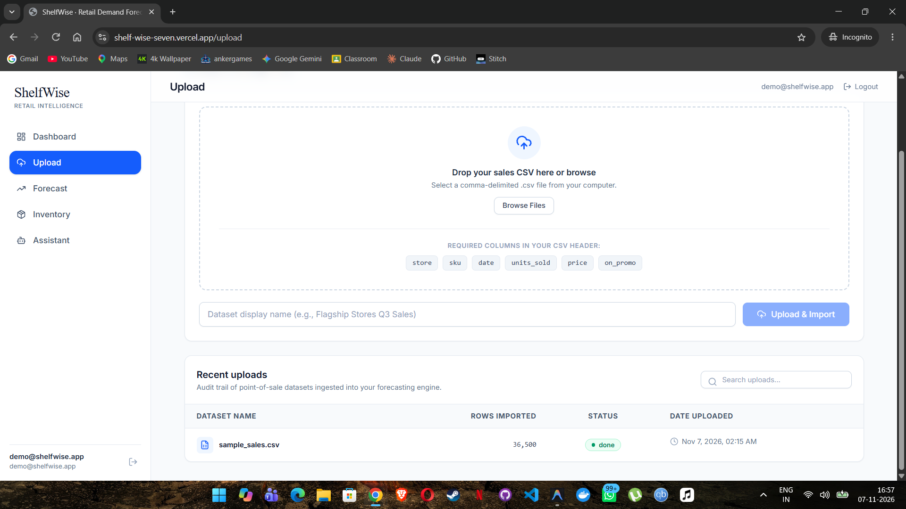
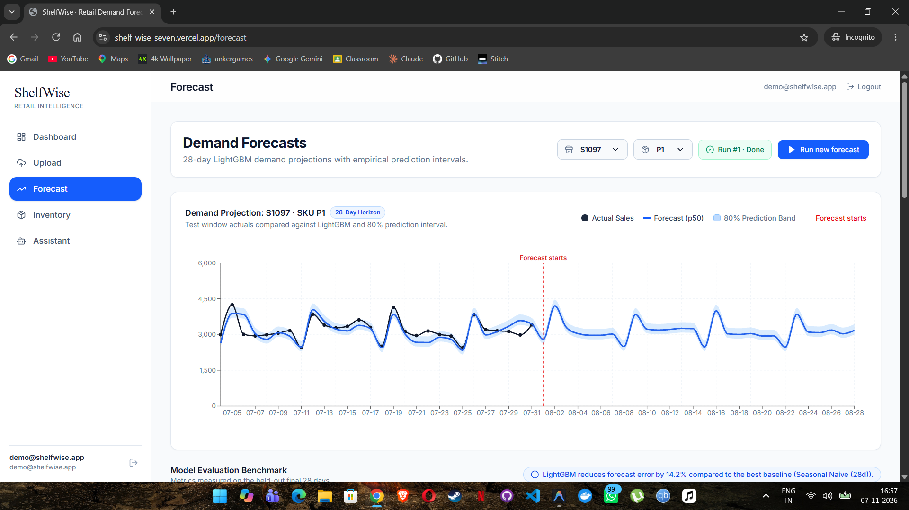
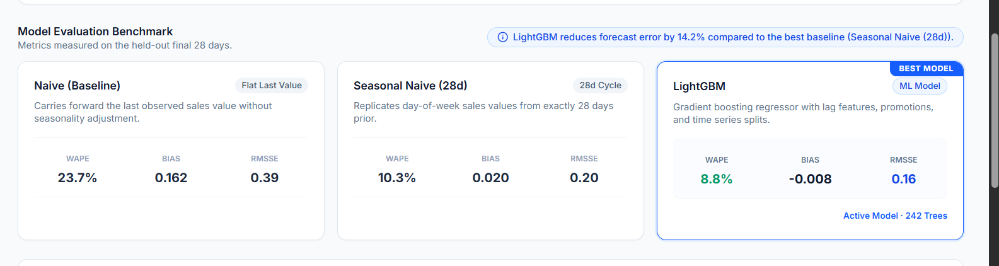
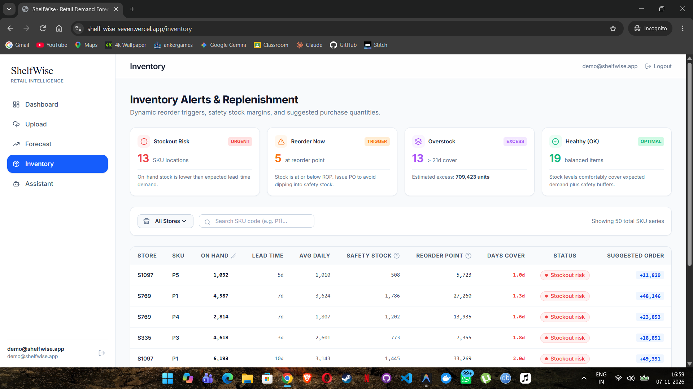
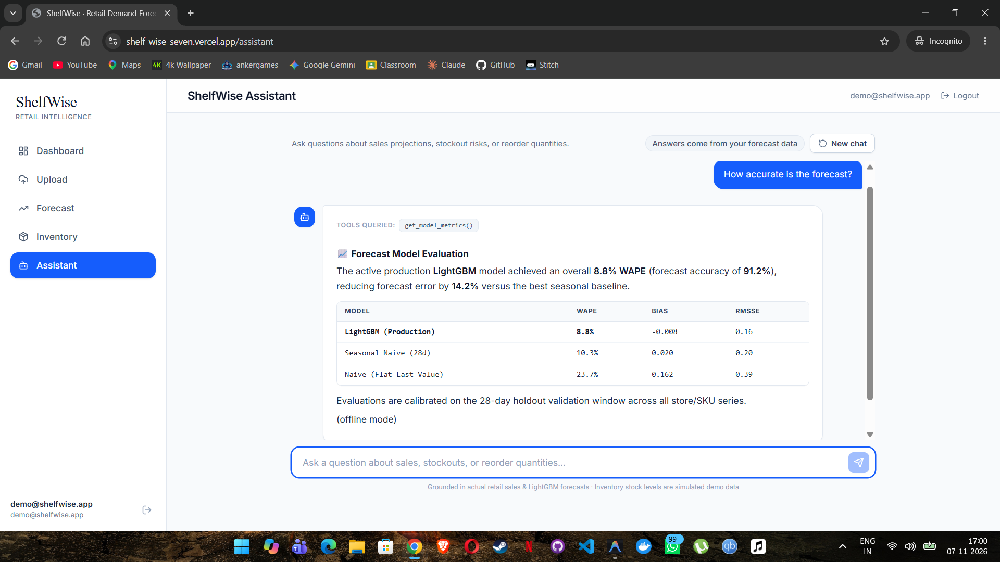

# ShelfWise

[](https://github.com/bonkey24/ShelfWise/actions/workflows/ci.yml)

> **Know what to stock, before the shelf runs empty.**

Watch the demo: https://youtu.be/tr1qxtZYlLM

ShelfWise is a retail demand forecasting web application that helps store managers and analysts predict future product demand, optimize inventory levels, and avoid costly stockouts or overstock situations.

## Live Demo

- **Demo video (YouTube):** https://youtu.be/tr1qxtZYlLM
- **Live app:** https://shelf-wise-seven.vercel.app/
- **API:** https://shelfwise-2aol.onrender.com
- **Demo login:** `demo@shelfwise.app` / `Demo@12345` (demo account only)

> The backend runs on a free Render instance, so the first request after a period of inactivity can take about a minute. Sales data is adapted from Rossmann; SKUs, prices and stock levels are simulated.

---

## ✨ Features

- 📂 **CSV Upload with Validation** — Upload historical sales data with automatic schema validation and error reporting
- 📈 **LightGBM Forecasts with Baseline Comparison** — ML-powered demand forecasts always benchmarked against a naive baseline (metrics: WAPE, bias, RMSSE)
- 🛡️ **Safety Stock, Reorder Points & Alerts** — Automated inventory policy recommendations with configurable alert thresholds
- 🔐 **SSO Login via OIDC** — Secure single sign-on using OpenID Connect
- 🤖 **AI Assistant** — Conversational assistant that answers questions grounded in your forecast data

---

## 📊 Data and Limitations

- **Dataset**: Historical sales data is adapted from Rossmann store-level sales; SKUs, unit prices, and on-hand inventory levels are simulated for demonstration.
- **Forecasting Horizon**: The model performs a 28-day-ahead planning forecast where all lag features are 28 days or greater. Evaluation is conducted on a held-out final 28-day test period, with a preceding 28-day validation window used for early stopping.
- **Benchmarks & Performance**: Benchmarked against naive, 7-day seasonal naive, and 28-day seasonal naive baselines. LightGBM improves WAPE by approximately 14% over the best baseline (0.0884 vs 0.1030) and outperforms baselines on 9 out of 10 stores.
- **Uncertainty Estimates**: Prediction intervals represent an empirical 80% range (10th to 90th percentile) calibrated on test-window residuals; they are likely slightly optimistic for longer horizons.
- **Execution Model**: Forecast training pipelines execute inside background Python threads without a dedicated Celery job queue.

---

## 🛠️ Tech Stack

| Layer | Technology |
|---|---|
| Backend API | Django 5, Django REST Framework, drf-spectacular |
| Database | PostgreSQL 16 |
| Background jobs | Python threads (no Celery) |
| ML / Forecasting | Python, Pandas, LightGBM, scikit-learn |
| Frontend | React, TypeScript, Vite, Tailwind CSS |
| Auth | OIDC / SSO |

---

## 👾 Development Notes

Developed with AI-assisted coding (Claude, Antigravity). UI mockups from Google Stitch.

---

## 🚀 Setup & Execution

### Ports & Credentials

| Service | Address / URL | Notes |
|---|---|---|
| **Frontend Web App** | [http://localhost:5173](http://localhost:5173) | Vite dev server / Nginx container |
| **Backend API** | [http://localhost:8000](http://localhost:8000) | Django REST Framework API |
| **Swagger / OpenAPI** | [http://localhost:8000/api/docs/](http://localhost:8000/api/docs/) | Interactive API documentation |
| **PostgreSQL Database** | `localhost:5433` | Host port 5433 mapped to avoid local 5432 conflict |
| **Redis** | `localhost:6379` | Provisioned in Docker, not used by the app at runtime |
| **Demo User** | `demo@shelfwise.app` | Password: `Demo@12345` |

---

### Configuration & Environment Variables

Copy the example environment configuration into `backend\.env` and `frontend\.env`:

```powershell
# Copy backend environment configuration
Copy-Item .env.example backend\.env

# Copy frontend environment configuration
Copy-Item frontend\.env.example frontend\.env
```

Key environment settings:
- **Database & Cache (`backend\.env`)**: Pre-configured for local Docker backing services (`DB_PORT=5433`, `REDIS_URL=redis://localhost:6379/0`).
- **Frontend Settings (`frontend\.env`)**: Pre-configured for local development (`VITE_API_URL=http://localhost:8000/api`, `VITE_SHOW_DEMO_LOGIN=true` enabling one-click demo credentials).
- **Google SSO Login (OIDC)**:
  ```env
  OIDC_ISSUER=https://accounts.google.com
  OIDC_CLIENT_ID=your-google-client-id.apps.googleusercontent.com
  OIDC_CLIENT_SECRET=your-google-client-secret
  OIDC_REDIRECT_URI=http://localhost:8000/api/auth/sso/callback/
  FRONTEND_URL=http://localhost:5173
  ```
- **AI Assistant LLM**:
  ```env
  LLM_PROVIDER=gemini # 'gemini' | 'anthropic' | 'none'
  LLM_API_KEY=your-api-key-here
  LLM_MODEL=gemini-3.5-flash # or claude-3-5-sonnet-20241022
  ```
  > **Note on AI Assistant**: Without an LLM key (or with `LLM_PROVIDER=none`), the ShelfWise Assistant automatically operates in **offline mode**, using deterministic, grounded logic and SQL/Pandas tools to answer inventory, reorder, stockout, and forecast accuracy questions.

---

### Run with Docker

To build and run all services (PostgreSQL, Redis, Django backend, and React/Nginx frontend) with demo data automatically migrated and seeded:

```powershell
# Start all containers in the background
docker compose --profile app up --build -d

# View container logs
docker compose logs -f backend

# Open the application
Start-Process "http://localhost:5173"

# Stop the application (preserves database volumes)
docker compose --profile app down
```

> To start **only** the PostgreSQL and Redis backing services in Docker (e.g. for local code development):
> ```powershell
> docker compose up -d
> ```

---

### Run Locally (Without Docker)

#### 1. Start Backing Services
Ensure Docker Desktop is running and launch PostgreSQL (port 5433) and Redis (port 6379):
```powershell
docker compose up -d
```

#### 2. Backend Setup
In a PowerShell terminal:
```powershell
# Create and activate virtual environment
python -m venv backend\venv
.\backend\venv\Scripts\Activate.ps1

# Install pinned dependencies
pip install -r backend\requirements.txt

# Apply database migrations
python backend\manage.py migrate

# Seed sales data, demo user, baseline forecast run, and inventory stock levels
python backend\manage.py load_demo_data

# Start Django development server
python backend\manage.py runserver 8000
```

#### 3. Frontend Setup
In a separate PowerShell terminal:
```powershell
cd frontend
Copy-Item .env.example .env
npm install
npm run dev
```

Navigate to `http://localhost:5173` and sign in with `demo@shelfwise.app` / `Demo@12345`.

---

### Running Tests

```powershell
# Run backend pytest suite (97 tests covering ML forecasting, APIs, OIDC, seeders, and AI assistant)
.\backend\venv\Scripts\pytest.exe backend

# Run frontend build & TypeScript check
npm --prefix frontend run build
```

---

## 🌐 Deploy on Render and Vercel

ShelfWise is configured for cloud deployment with a containerized Django backend on [Render](https://render.com) and a high-performance React SPA on [Vercel](https://vercel.com).

### 1. Backend Deployment (Render)

1. **Create a PostgreSQL Database on Render**:
   - Create a new PostgreSQL instance (free tier).
   - Note the **Internal Database URL** (or individual host, port, database, user, password credentials).

2. **Create a Web Service on Render**:
   - Connect your GitHub repository.
   - Choose **Docker** as the Environment / Runtime.
   - Set **Root Directory** to `backend` and **Dockerfile Path** to `Dockerfile`.
   - Set the instance type (Free tier or higher).

3. **Configure Environment Variables on Render**:
   - `DJANGO_SECRET_KEY`
   - `DJANGO_DEBUG` (`False`)
   - `ALLOWED_HOSTS` (e.g. `your-app-name.onrender.com`)
   - `FRONTEND_URL` (e.g. `https://your-frontend.vercel.app`)
   - `EXTRA_ORIGINS` (optional: comma-separated extra allowed origins)
   - `DB_HOST`
   - `DB_PORT`
   - `DB_NAME`
   - `DB_USER`
   - `DB_PASSWORD`
   - `LIGHTGBM_NUM_THREADS` (set to `1` or `2` to keep memory well within the 512 MB free tier threshold)
   - `LLM_PROVIDER` (optional: `gemini`, `anthropic`, or `none`)
   - `LLM_API_KEY` (optional)
   - `LLM_MODEL` (optional)
   - `OIDC_ISSUER` (optional)
   - `OIDC_CLIENT_ID` (optional)
   - `OIDC_CLIENT_SECRET` (optional)
   - `OIDC_REDIRECT_URI` (optional)

> [!NOTE]
> **Cold Starts on Render Free Tier**:
> On Render's free tier, containers spin down after 15 minutes of inactivity. When a new request arrives, a cold start takes approximately 50 seconds while the container boots, executes migrations, starts demo-data verification in the background, and binds Gunicorn to `${PORT}`. Once warm, requests respond in milliseconds.

---

### 2. Frontend Deployment (Vercel)

1. **Import Project into Vercel**:
   - Connect your GitHub repository.
   - Set **Root Directory** to `frontend`.
   - Framework preset will automatically detect **Vite**.
   - Build command: `npm run build` (outputs to `dist`).
   - SPA route rewrites are automatically handled by [`frontend/vercel.json`](frontend/vercel.json).

2. **Configure Environment Variables on Vercel**:
   - `VITE_API_URL` (e.g. `https://your-app-name.onrender.com/api`)
   - `VITE_SHOW_DEMO_LOGIN` (`true`)

3. **Finalize CORS**:
   - Ensure the Vercel production domain is configured as `FRONTEND_URL` in the Render backend settings.

---

## Screenshots

| | |
|---|---|
|  |  |
|  |  |
|  |  |
|  | |