# ShelfWise Database Documentation

## 1. Database Architecture & Technology

ShelfWise uses PostgreSQL 16 as its relational persistence layer across both local development and production deployments.

- **Relational Engine**: PostgreSQL 16
- **Database Driver**: `psycopg` (version 3.2+) managed via Django ORM (`django.db.backends.postgresql`).
- **Local Development Environment**: Containerized PostgreSQL running in the `shelfwise-db-1` Docker service. The host port is mapped to **5433** (container port 5432) to prevent port collisions with any local PostgreSQL instance installed on the host machine.
- **Production Environment**: Managed PostgreSQL 16 hosted on Render, provisioned in the same cloud region as the web service and connected via TLS using environment variables.

---

## 2. Entity-Relationship (ER) Diagram

The following Mermaid diagram displays the relational schema, foreign key associations, and multiplicity across all application tables.

```mermaid
erDiagram
    auth_user ||--|| accounts_userprofile : "extends (1:1)"
    retail_store ||--o{ retail_sale : "records (1:N)"
    retail_product ||--o{ retail_sale : "sold_in (1:N)"
    datasets_dataset ||--o{ forecasts_forecastrun : "produces (1:N)"
    forecasts_forecastrun ||--o{ forecasts_forecastresult : "contains (1:N)"
    retail_store ||--o{ forecasts_forecastresult : "targets (1:N)"
    retail_product ||--o{ forecasts_forecastresult : "projects (1:N)"
    retail_store ||--o{ inventory_stocklevel : "maintains (1:N)"
    retail_product ||--o{ inventory_stocklevel : "tracked_at (1:N)"

    auth_user {
        int id PK
        varchar password
        timestamp last_login
        boolean is_superuser
        varchar username UK
        varchar first_name
        varchar last_name
        varchar email
        boolean is_staff
        boolean is_active
        timestamp date_joined
    }

    accounts_userprofile {
        bigint id PK
        int user_id FK,UK
        varchar auth_provider
    }

    retail_store {
        bigint id PK
        varchar code UK
        varchar name
    }

    retail_product {
        bigint id PK
        varchar sku UK
        varchar name
        varchar category
    }

    retail_sale {
        bigint id PK
        bigint store_id FK
        bigint product_id FK
        date date
        double_precision units_sold
        double_precision price
        boolean on_promo
    }

    datasets_dataset {
        bigint id PK
        varchar name
        varchar file
        int rows_imported
        varchar status
        text error
        timestamp created_at
    }

    forecasts_forecastrun {
        bigint id PK
        bigint dataset_id FK
        varchar status
        int horizon_days
        jsonb metrics
        text error
        timestamp created_at
        timestamp finished_at
    }

    forecasts_forecastresult {
        bigint id PK
        bigint run_id FK
        bigint store_id FK
        bigint product_id FK
        date date
        double_precision forecast
        double_precision lower
        double_precision upper
        double_precision actual
    }

    inventory_stocklevel {
        bigint id PK
        bigint store_id FK
        bigint product_id FK
        double_precision on_hand
        int lead_time_days
        double_precision service_level
        timestamp updated_at
    }
```

---

## 3. Detailed Table Specifications

### A. `retail_store` (Model: `Store`)
Represents a physical or logical retail store branch.

| Column | Data Type | Nullable | Default | Constraints & Description |
| :--- | :--- | :--- | :--- | :--- |
| `id` | `bigint` / `BigAutoField` | No | Auto-increment | Primary key. |
| `code` | `varchar(50)` | No | None | Unique store identifier (e.g., store code or number). |
| `name` | `varchar(200)` | No | `''` (blank) | Human-readable name or description for the store branch. |

### B. `retail_product` (Model: `Product`)
Represents an individual SKU sold across store locations.

| Column | Data Type | Nullable | Default | Constraints & Description |
| :--- | :--- | :--- | :--- | :--- |
| `id` | `bigint` / `BigAutoField` | No | Auto-increment | Primary key. |
| `sku` | `varchar(50)` | No | None | Unique SKU or item identifier. |
| `name` | `varchar(200)` | No | `''` (blank) | Display name of the product. |
| `category` | `varchar(100)` | No | `''` (blank) | Merchandising department or category classification. |

### C. `retail_sale` (Model: `Sale`)
Records observed historical daily transaction volume for a specific store and product combination.

| Column | Data Type | Nullable | Default | Constraints & Description |
| :--- | :--- | :--- | :--- | :--- |
| `id` | `bigint` / `BigAutoField` | No | Auto-increment | Primary key. |
| `store_id` | `bigint` | No | None | Foreign key referencing `retail_store(id)` ON DELETE CASCADE. |
| `product_id` | `bigint` | No | None | Foreign key referencing `retail_product(id)` ON DELETE CASCADE. |
| `date` | `date` | No | None | Observation date. Indexed (`db_index=True`). |
| `units_sold` | `double precision` | No | None | Unit volume sold on this date. |
| `price` | `double precision` | Yes | `NULL` | Selling price or unit price on this date. |
| `on_promo` | `boolean` | No | `FALSE` | Indicates whether a promotional discount was active. |

- **Unique Constraint**: `unique_together = [('store', 'product', 'date')]` prevents duplicate sales records for the same store and SKU on any given date.
- **Composite Index**: `sale_store_product_date_idx` on `(store_id, product_id, date)`.

### D. `datasets_dataset` (Model: `Dataset`)
Tracks historical CSV files uploaded by users for model training.

| Column | Data Type | Nullable | Default | Constraints & Description |
| :--- | :--- | :--- | :--- | :--- |
| `id` | `bigint` / `BigAutoField` | No | Auto-increment | Primary key. |
| `name` | `varchar(200)` | No | None | Original filename of the uploaded dataset. |
| `file` | `varchar(100)` | No | None | File path in the media storage directory (`uploads/`). |
| `rows_imported` | `integer` | No | `0` | Count of validated sales records imported into `retail_sale`. |
| `status` | `varchar(20)` | No | `'pending'` | Ingestion status (`pending`, `success`, `failed`). |
| `error` | `text` | No | `''` (blank) | Ingestion error trace or Pandera validation error message. |
| `created_at` | `timestamp with time zone` | No | `NOW()` | Timestamp when the upload was registered. |

### E. `forecasts_forecastrun` (Model: `ForecastRun`)
Maintains metadata, lifecycle status, and evaluation metrics for an end-to-end forecasting pipeline execution.

| Column | Data Type | Nullable | Default | Constraints & Description |
| :--- | :--- | :--- | :--- | :--- |
| `id` | `bigint` / `BigAutoField` | No | Auto-increment | Primary key. |
| `dataset_id` | `bigint` | Yes | `NULL` | Foreign key referencing `datasets_dataset(id)` ON DELETE SET_NULL. |
| `status` | `varchar(20)` | No | `'pending'` | Lifecycle state: `pending`, `running`, `done`, `failed`. |
| `horizon_days` | `integer` | No | `28` | Future forecast projection window in days. |
| `metrics` | `jsonb` | No | `{}` | Evaluation metrics (WAPE, bias, RMSSE, baseline comparisons). |
| `error` | `text` | No | `''` (blank) | Execution error message if the run failed. |
| `created_at` | `timestamp with time zone` | No | `NOW()` | Timestamp when the run was requested. |
| `finished_at` | `timestamp with time zone` | Yes | `NULL` | Timestamp when model training and inference completed. |

- **Default Ordering**: `['-created_at']` (newest runs appear first).

### F. `forecasts_forecastresult` (Model: `ForecastResult`)
Stores point forecasts, 80% empirical prediction intervals, and holdout ground-truth actuals for each daily series point.

| Column | Data Type | Nullable | Default | Constraints & Description |
| :--- | :--- | :--- | :--- | :--- |
| `id` | `bigint` / `BigAutoField` | No | Auto-increment | Primary key. |
| `run_id` | `bigint` | No | None | Foreign key referencing `forecasts_forecastrun(id)` ON DELETE CASCADE. |
| `store_id` | `bigint` | No | None | Foreign key referencing `retail_store(id)` ON DELETE CASCADE. |
| `product_id` | `bigint` | No | None | Foreign key referencing `retail_product(id)` ON DELETE CASCADE. |
| `date` | `date` | No | None | Calendar date of the projection or holdout test point. |
| `forecast` | `double precision` | No | None | Predicted demand volume. |
| `lower` | `double precision` | No | None | Lower bound of the 80% empirical prediction interval (10th percentile). |
| `upper` | `double precision` | No | None | Upper bound of the 80% empirical prediction interval (90th percentile). |
| `actual` | `double precision` | Yes | `NULL` | Observed ground truth (populated for holdout test window points). |

- **Composite Index**: `forecasts_f_run_id_bda383_idx` on `(run_id, store_id, product_id, date)`.
- **Default Ordering**: `['date', 'store', 'product']`.

### G. `inventory_stocklevel` (Model: `StockLevel`)
Tracks physical inventory on hand and replenishment policy configurations for every store and SKU pair.

| Column | Data Type | Nullable | Default | Constraints & Description |
| :--- | :--- | :--- | :--- | :--- |
| `id` | `bigint` / `BigAutoField` | No | Auto-increment | Primary key. |
| `store_id` | `bigint` | No | None | Foreign key referencing `retail_store(id)` ON DELETE CASCADE. |
| `product_id` | `bigint` | No | None | Foreign key referencing `retail_product(id)` ON DELETE CASCADE. |
| `on_hand` | `double precision` | No | None | Current physical inventory balance on hand. |
| `lead_time_days` | `integer` | No | `7` | Supplier delivery lead time in days. |
| `service_level` | `double precision` | No | `0.95` | Target cycle service level factor (Z = 1.65 for 95%). |
| `updated_at` | `timestamp with time zone` | No | `NOW()` | Timestamp of the most recent stock update or policy change. |

- **Unique Constraint**: `unique_together = [('store', 'product')]` guarantees exactly one inventory position per store and SKU.
- **Composite Index**: `inventory_s_store_i_3f806e_idx` on `(store_id, product_id)`.
- **Default Ordering**: `['store', 'product']`.

### H. `auth_user` (Django Auth User)
Standard Django authentication user table.

| Column | Data Type | Nullable | Default | Constraints & Description |
| :--- | :--- | :--- | :--- | :--- |
| `id` | `integer` / `bigint` | No | Auto-increment | Primary key. |
| `password` | `varchar(128)` | No | None | PBKDF2 with SHA-256 password hash. |
| `last_login` | `timestamp with time zone` | Yes | `NULL` | Timestamp of the user's last authentication. |
| `is_superuser` | `boolean` | No | `FALSE` | Grants all permissions without explicit assignment. |
| `username` | `varchar(150)` | No | None | Unique account username (populated with user email). |
| `first_name` | `varchar(150)` | No | `''` (blank) | User given name. |
| `last_name` | `varchar(150)` | No | `''` (blank) | User surname. |
| `email` | `varchar(254)` | No | `''` (blank) | Primary email address. |
| `is_staff` | `boolean` | No | `FALSE` | Controls access to the Django administrative site. |
| `is_active` | `boolean` | No | `TRUE` | Soft-deletion flag indicating whether the account can log in. |
| `date_joined` | `timestamp with time zone` | No | `NOW()` | Account creation timestamp. |

### I. `accounts_userprofile` (Model: `UserProfile`)
Extends the standard Django user model with identity provider metadata.

| Column | Data Type | Nullable | Default | Constraints & Description |
| :--- | :--- | :--- | :--- | :--- |
| `id` | `bigint` / `BigAutoField` | No | Auto-increment | Primary key. |
| `user_id` | `integer` / `bigint` | No | None | Unique foreign key to `auth_user(id)` ON DELETE CASCADE. |
| `auth_provider` | `varchar(50)` | No | `'email'` | Account origin: `'email'` (password login) or `'sso'` (Google OIDC). |

---

## 4. Database Indexes & Query Justifications

Every non-primary index in the schema was created to optimize specific, high-frequency operational queries.

| Table | Index Name | Indexed Columns | Justifying Operational Query & Purpose |
| :--- | :--- | :--- | :--- |
| `retail_sale` | `sale_store_product_date_idx` | `(store_id, product_id, date)` | Optimizes time-series grouping, sequential sorting for lag feature extraction, and unique row lookups during CSV import. |
| `retail_sale` | `retail_sale_date_idx` | `(date)` | Fast filtering across all series by calendar windows, such as computing recent 28-day sales averages or defining validation/test splits. |
| `forecasts_forecastresult` | `forecasts_f_run_id_bda383_idx` | `(run_id, store_id, product_id, date)` | Powers the interactive forecast visualization chart and assistant tools by retrieving daily projections for a selected store, SKU, and run. |
| `inventory_stocklevel` | `inventory_s_store_i_3f806e_idx` | `(store_id, product_id)` | Accelerates inventory status evaluations and single-item stock balance updates when users edit on-hand quantities. |
| `retail_store` | `retail_store_code_key` | `(code)` | Enforces code uniqueness and ensures constant-time lookup during CSV import and series filtering. |
| `retail_product` | `retail_product_sku_key` | `(sku)` | Enforces SKU uniqueness and accelerates item resolution during dataset parsing. |
| `auth_user` | `auth_user_username_key` | `(username)` | Constant-time lookup of user credentials during login and Google OIDC authentication. |

---

## 5. Ownership, Authorization & Data Scope

- **Shared Data Domain**: ShelfWise implements a shared, single-tenant data model. All retail sales, store definitions, products, datasets, forecasts, and inventory stock levels are globally shared across all authenticated users.
- **No Per-User Data Partitioning**: There are no foreign keys linking `retail_sale`, `datasets_dataset`, `forecasts_forecastrun`, or `inventory_stocklevel` to `auth_user`. Any authenticated user can view existing forecasts, trigger new runs, upload sales CSVs, and adjust inventory policies.
- **Binary Access Control**: Authorization is binary: requests are either unauthenticated (restricted to public endpoints) or authenticated (granted full read and write access across all application endpoints).

---

## 6. Sensitive-Data Handling & Security Boundaries

- **Password Hashes Only**: Passwords are never stored in plaintext. They are hashed using Django's default PBKDF2 implementation with SHA-256 and salt, stored exclusively in `auth_user.password`.
- **No Token Storage**: JSON Web Tokens (JWT access and refresh tokens) are stateless cryptographic signatures using HMAC-SHA256. They are issued to the browser and held in client `localStorage`. The database does not store active session tokens.
- **No Third-Party Credentials**: Google OIDC access and identity tokens are verified in memory during the OAuth callback and immediately discarded. External API keys (`GOOGLE_CLIENT_SECRET`, `GEMINI_API_KEY`) are read exclusively from environment variables and are never stored in the database.

---

## 7. Migration Strategy & Status

- **Management Framework**: Database schema evolution is governed strictly through Django migrations.
- **Automated Startup Migration**: The container initialization script (`docker-entrypoint.sh`) runs `python manage.py migrate --noinput` synchronously before Gunicorn starts, ensuring database schema is up to date before HTTP traffic is accepted.
- **Model-Migration Consistency Check**: Running `python manage.py makemigrations --check` from `backend/` outputs **`No changes detected`** (exit code 0), verifying that all current Django models match existing migration files with zero unapplied or missing schema changes.

---

## 8. Data Seeding Strategy & Idempotence

ShelfWise includes two management commands that seed initial data while guaranteeing strict idempotence:

### A. `load_demo_data`
- **Purpose**: Prepares a fully operational demonstration environment on initial deployment.
- **Execution Workflow**:
  1. Checks if any rows exist in `retail_sale`. If sales records already exist, CSV import is skipped.
  2. If empty, imports sales records from `sample_sales.csv` (checking `DEMO_DATA_PATH`, `/data/sample_sales.csv`, `/app/demo_data/sample_sales.csv`, or local repository paths).
  3. Ensures the demo user (`demo@shelfwise.app` / `Demo@12345`) exists, updating the password if the user already exists.
  4. Checks if a completed forecast run exists. If found, skips model training; if not, triggers an initial 28-day baseline forecast run.
  5. Invokes `seed_stock`.
- **Idempotence**: Safe to run repeatedly. Existing sales records, completed forecast runs, and user accounts are preserved without duplication.

### B. `seed_stock`
- **Purpose**: Generates realistic stock balances and replenishment scenarios for all store and SKU combinations.
- **Execution Workflow**:
  - Employs an independent, deterministic pseudo-random number generator per series (seeded with store code, SKU, and seed suffix `42`).
  - Distributes inventory scenarios across realistic proportions: 20% stockout risk, 15% reorder now, 40% healthy (OK), and 25% overstock.
  - Writes records using `StockLevel.objects.update_or_create(store=store, product=product, defaults={...})`.
- **Idempotence**: Running the command multiple times updates existing `StockLevel` rows without violating the `(store, product)` unique constraint or creating duplicate rows.

---

## 9. Backup, Persistence & Recovery Notes

- **Local Development**:
  - PostgreSQL data files reside inside a named Docker volume (`shelfwise_postgres_data`).
  - Stopping or recreating Docker containers does not destroy local database records.
- **Render Production Environment**:
  - The free-tier Render PostgreSQL instance is ephemeral: free databases expire and are automatically deleted after 30 days of creation.
  - Free-tier databases do not include automated daily backups or point-in-time recovery (PITR).
  - **Cold Boot Disaster Recovery**: Because `load_demo_data` is configured in `docker-entrypoint.sh`, any newly provisioned replacement database automatically self-heals upon container launch by recreating the schema, seeding the demo user, importing the bundled sales dataset, generating the baseline forecast, and initializing inventory stock levels.
  - **Production Upgrade Path**: Production deployments requiring high durability and compliance should upgrade to a paid Render PostgreSQL plan, which provides persistent non-expiring disks, automated daily backups, and point-in-time restore capability.

